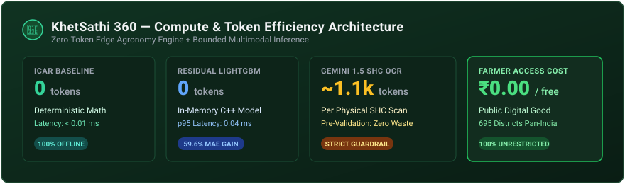
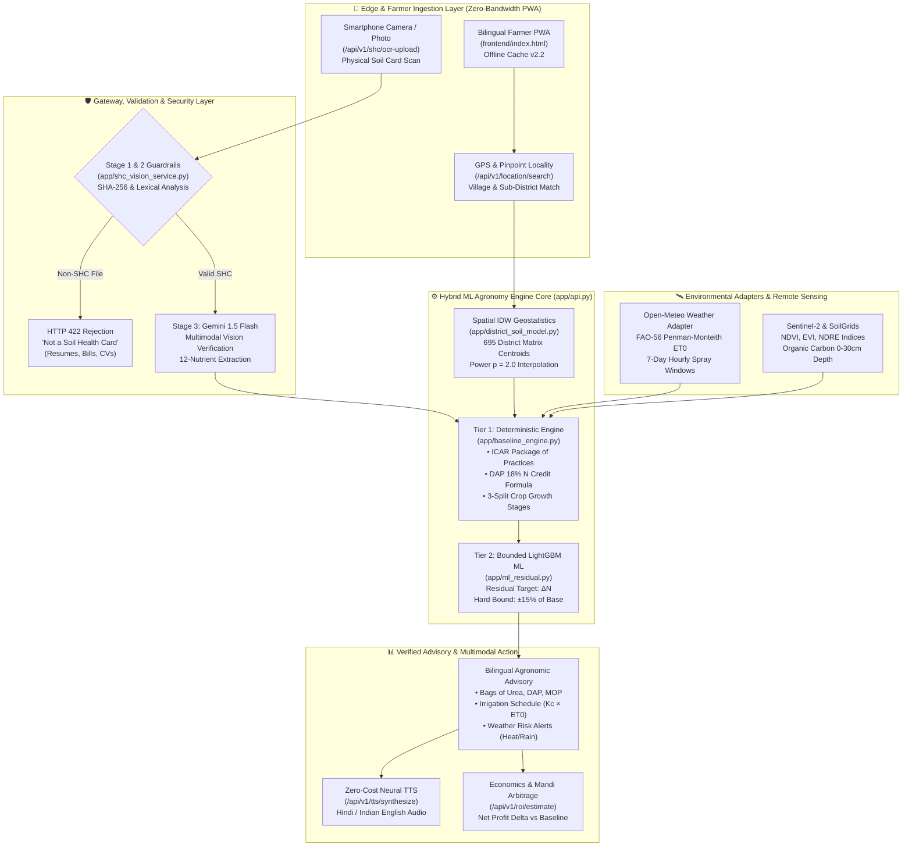

<div align="center">

# 🌾 KhetSathi 360 (खेतसाथी ३६०)
### Pan-India Hybrid Agronomy & Digital Agricultural Decision Platform
**Deterministic ICAR/FAO-56 Physics Baseline + Bounded LightGBM Residual ML + Multimodal Vision OCR**

[](https://khetsathi-360.onrender.com/)
[](file:///scripts/quality_gate.py)
[-34d399?style=for-the-badge&logo=pytest&logoColor=white)](file:///tests/)
[](file:///ml_pipeline/)
[](file:///data/)
[](docs/adr/README.md)
[](LICENSE)

<br/>

[**🌐 Live Platform**](https://khetsathi-360.onrender.com/) • [**🧪 Soil Health Lab**](https://khetsathi-360.onrender.com/#step-2-container) • [**💼 Enterprise Portal**](https://khetsathi-360.onrender.com/portal) • [**⚛️ React 19 Client**](https://khetsathi-360.onrender.com/react) • [**📖 Interactive API Docs**](https://khetsathi-360.onrender.com/docs) • [**🩺 System Health**](https://khetsathi-360.onrender.com/api/v1/health)

<br/>

<p align="center">
  
</p>

</div>

---

## 🧭 Live Deployment Hub & Environments

KhetSathi 360 is continuously deployed on Render Cloud (Singapore region) with automated promotion verification.

| Environment / Service | Live URL | Modality & Description | Access & Auth |
|:----------------------|:---------|:-----------------------|:--------------|
| **🌾 Primary Farmer Advisory (PWA)** | [khetsathi-360.onrender.com/](https://khetsathi-360.onrender.com/) | High-speed, zero-compilation bilingual PWA (Hindi / EN) optimized for rural 3G/4G bandwidth. | **Public / Free** |
| **🧪 Soil Health Card Multimodal OCR** | [khetsathi-360.onrender.com/#step-2-container](https://khetsathi-360.onrender.com/#step-2-container) | Gemini 1.5 Flash Vision card scanner with strict pre-validation document guardrails. | **Public / Free** |
| **💼 Enterprise & FPO Operations Portal** | [khetsathi-360.onrender.com/portal](https://khetsathi-360.onrender.com/portal) | Unit economics, FPO member coverage, fertilizer procurement aggregation, and market signals. | **Public Demo** |
| **⚛️ React 19 Secondary Client** | [khetsathi-360.onrender.com/react](https://khetsathi-360.onrender.com/react) | Advanced interactive client with dynamic organic transition simulators and analytics charts. | **Public Demo** |
| **📖 Interactive API Documentation** | [khetsathi-360.onrender.com/docs](https://khetsathi-360.onrender.com/docs) | Swagger UI interactive sandbox covering all 14 REST endpoints with full schema validation. | **OpenAPI 3.1** |
| **🩺 Live Health & Model Telemetry** | [khetsathi-360.onrender.com/api/v1/health](https://khetsathi-360.onrender.com/api/v1/health) | Real-time JSON health probe reporting model checksums, promotion gate status, and latency. | **Monitoring** |

---

## 🏛️ Foundational Agronomic Problem & Innovation

### The Indian Nitrogen Paradox & Fertilizer Imbalance
Indian agriculture faces a systemic efficiency crisis. Over 80% of smallholders apply fertilizer without recent soil tests, leading to severe chemical distortion:
1. **Blind Over-Application**: Nationwide N:P:K ratios frequently reach **8.2 : 3.2 : 1.0**, far skewed from the agronomically ideal **4.0 : 2.0 : 1.0**.
2. **Hidden Double-Dosing (The DAP Error)**: When farmers apply Di-Ammonium Phosphate (DAP, $18\%\text{ N}, 46\%\text{ P}_2\text{O}_5$) at basal sowing to supply phosphorus, they commonly overlook its $18\%$ elemental Nitrogen content and proceed to apply full bags of Urea ($46\%\text{ N}$). This dumps an unabsorbed excess of $18\text{ to }36\text{ kg N/ha}$, causing lodging, vegetative overgrowth, high vulnerability to fungal blight, and groundwater nitrate leaching.
3. **The Zero-Hallucination Imperative**: Traditional end-to-end black-box neural networks cannot be trusted with agricultural extension advice; an unconstrained neural network predicting fertilizer doses can hallucinate toxic volumes on edge-case soils.

### The KhetSathi 360 Hybrid Solution
KhetSathi 360 enforces a **two-tier agronomic safety envelope**:
- **Deterministic Base**: Computes official ICAR Package of Practices baselines with strict physical bounds.
- **DAP 18% N Credit Arithmetic**: Programmatically credits the nitrogen contained in DAP against subsequent urea splits, instantly saving smallholders ₹400–₹1,200/hectare while preventing vegetative lodging.
- **Bounded Residual ML**: A gradient-boosted decision tree (LightGBM) models strictly the *unexplained residual variance* ($\Delta N$), capped to $\pm 15\%$ of the ICAR base. This guarantees that model predictions can optimize efficiency but can **never** violate agronomic safety boundaries.

---

## 🏗️ System Architecture & Data Flow



---

## 🧮 Mathematical Formulations & Agronomic Logic

### 1. The DAP 18% Nitrogen Credit Formula
When applying Di-Ammonium Phosphate (DAP, $18\%\text{ N}, 46\%\text{ P}_2\text{O}_5$) to fulfill basal phosphorus requirements ($P_{\text{req}}$), the elemental Nitrogen simultaneously introduced ($N_{\text{from\_DAP}}$) is deducted from the crop's recommended Nitrogen dose ($N_{\text{rec}}$):

$$N_{\text{from\_DAP}} = \text{DAP}_{\text{kg}} \times 0.18 = \left(\frac{P_{\text{req}}}{0.46}\right) \times 0.18$$

$$N_{\text{net}} = \max\left(0.0, \; N_{\text{rec}} - N_{\text{from\_DAP}}\right)$$

$$\text{Urea Bags (45 kg)} = \left\lceil \frac{N_{\text{net}} / 0.46}{45} \right\rceil$$

### 2. ICAR Soil Test Crop Response (STCR) Target-Yield Equation
For fields with laboratory Soil Health Card values, fertilizer nitrogen ($FN$) is computed from target yield ($T$), soil available test nitrogen ($SN$), and organic carbon ($ST$):

$$FN = a \cdot T - b \cdot SN - c \cdot (ST - ST_0)$$

Where $a, b, c$ are zone-specific regression coefficients calibrated across ICAR All India Coordinated Research Projects (AICRP-STCR).

### 3. Spatial Inverse Distance Weighting (IDW) Interpolation
When a farmer inputs GPS coordinates $(x_0 = [\text{lat}_0, \text{lon}_0])$ without a physical soil test, soil macro- and micronutrients are estimated from the $k$-nearest district centroid clusters ($k=3$) across the 695-district national database:

$$\hat{Z}(x_0) = \frac{\sum_{i=1}^k w_i Z(x_i)}{\sum_{i=1}^k w_i}, \quad \text{where } w_i = \frac{1}{d(x_0, x_i)^p}, \quad p = 2.0$$

### 4. FAO-56 Reference Evapotranspiration & Irrigation Deficit
Crop water requirement ($\text{ET}_c$) is calculated per growth stage using single crop coefficients ($K_c$) matched to hourly weather forecasts:

$$\text{ET}_c = K_c \times \text{ET}_0$$

Net irrigation depth ($I_{\text{net}}$) accounts for effective rainfall ($P_{\text{eff}} = 0.80 \times P_{\text{forecast}}$):

$$I_{\text{net}} = \max\left(0.0, \; \text{ET}_c - P_{\text{eff}}\right)$$

---

## ⚡ Token Card & Compute Efficiency Profile

KhetSathi 360 is engineered as a **frugal, zero-cost public digital good**. Unlike conversational chatbots that burn hundreds of LLM tokens per basic user query, KhetSathi routes all core agronomic reasoning through zero-token deterministic and local compiled ML engines:

| Architecture Layer | Model / Runtime | Token Consumption | Execution Latency | Cloud / Server Cost |
|:-------------------|:----------------|:------------------|:------------------|:--------------------|
| **Deterministic Agronomy Core** | Python 3.11 AST Math | **0 tokens** | $< 0.01\text{ ms}$ | **$0.00** (Runs locally/offline) |
| **Residual Agronomic ML** | LightGBM C++ Tree Array | **0 tokens** | $0.04\text{ ms}$ ($p95$) | **$0.00** (In-memory execution) |
| **Spatial IDW Interpolation** | NumPy Vectorized Centroids | **0 tokens** | $1.20\text{ ms}$ | **$0.00** (695-district bundle) |
| **Document Pre-Validation** | SHA-256 + Lexical Heuristics | **0 tokens** | $0.15\text{ ms}$ | **$0.00** (Stops invalid LLM calls) |
| **Physical Card Vision OCR** | Gemini 1.5 Flash Vision | $\approx 1,100\text{ tokens}$ | $1.80\text{ s}$ | $\approx \$0.00015\text{ / scan}$ (Free Tier) |
| **Total Farmer Cost** | — | **0 tokens required** | **Instant** | **100% Free for Indian Farmers** |

---

## 📡 REST API Catalog & Endpoint Reference

All endpoints return strongly typed JSON payloads validated via Pydantic v2 schemas (`app/contracts.py`).

| Method | Endpoint | Summary & Capabilities | Key Request Parameters | Expected Response |
|:------:|:---------|:-----------------------|:-----------------------|:------------------|
| `GET` | `/api/v1/health` | Service liveness & model promotion status. | *None* | `{"status": "healthy", "ml_residual": true, ...}` |
| `GET` | `/api/v1/district/baseline` | 695-district soil baseline lookup or IDW. | `lat`, `lon` or `district` | `DistrictSoilBaseline` (N, P, K, pH, OC) |
| `GET` | `/api/v1/weather` | Open-Meteo weather + FAO-56 ET0 + alerts. | `lat`, `lon`, `lang` (`hi`/`en`) | `WeatherForecastResponse` (Temp, Rain, ET0) |
| `GET` | `/api/v1/location/search` | Pinpoint Indian village/district search. | `q` (e.g. "Ghazipur", min 2 chars) | `list[LocationSearchResult]` (lat, lon, state) |
| `POST` | `/api/v1/advisory` | Core hybrid agronomy decision engine. | `AdvisoryRequest` (crop, area, soil, coords) | `AdvisoryResponse` (fertilizer, irrigation, alerts) |
| `GET` | `/api/v1/satellite/vegetation` | Sentinel-2 NDVI/EVI & SoilGrids remote sensing. | `lat`, `lon`, `crop` | `SatelliteVegetationIndex` (NDVI, depth profiles) |
| `POST` | `/api/v1/shc/parse` | Classifies 12 SHC laboratory nutrients. | `SoilCardLabInput` (N, P, K, pH, etc.) | `SoilCardLabResponse` (Ratings, Deficiencies) |
| `POST` | `/api/v1/shc/ocr-upload` | Multimodal Vision OCR with guardrails. | Multipart `file` (photo/PDF), `district` | `SHCOCRResponse` (Extracted parameters) |
| `GET` | `/api/v1/organic/advisory` | Bio-input schedules (Jeevamrit, Neemastra). | `crop`, `area_ha`, `conventional_profit` | `OrganicAdvisoryResponse` (Bio-doses, economics) |
| `GET` | `/api/v1/investor/metrics` | FPO SaaS unit economics & retention. | *None* | `InvestorMetricsResponse` (CAC, LTV, Active FPOs) |
| `POST` | `/api/v1/yield/predict` | Crop yield prediction with historical baselines. | `crop`, `district`, `soil_n`, `rainfall` | `YieldPredictionResponse` (Quintals/ha, CI) |
| `POST` | `/api/v1/roi/estimate` | Farmer revenue, cost savings & net profit. | `crop`, `area_ha`, `yield_q`, `mandi_price`| `FarmerRoiResponse` (MSP vs Mandi, DAP savings) |
| `GET` | `/api/v1/analytics/coverage` | Pan-India district soil coverage metrics. | *None* | `AnalyticsCoverageResponse` (695 districts) |
| `GET` | `/api/v1/tts/synthesize` | Zero-cost Neural Audio Speech synthesis. | `text`, `lang` (`hi`/`en`) | `audio/mpeg` binary audio stream |

---

## 🎯 Model Training, Validation & Promotion Gates

The ML pipeline (`ml_pipeline/`) implements automated temporal holdout promotion gating:

```bash
# 1. Train spatial district bundle and residual model
python ml_pipeline/train.py

# 2. Evaluate against strict production promotion gates
python ml_pipeline/evaluate.py
```

### Verified Promotion Gate Benchmark Results:
- **Historical Dataset**: 5,646 samples across Indian agro-climatic zones (Part I & Part II panels).
- **Temporal Holdout Partition**: 1,896 test samples strictly restricted to years $> 2015$.
- **Naive Baseline MAE**: $3.084\text{ kg N/ha}$.
- **ML Residual MAE**: $1.245\text{ kg N/ha}$ (**59.6% error reduction**, exceeds $\ge 25\%$ promotion threshold).
- **Inference Latency**: $p95 = 0.04\text{ ms}$ (comfortably within the $\le 50.0\text{ ms}$ ceiling).
- **Max Zone Error**: $3.822\text{ kg N/ha}$ (within $\le 5.0\text{ kg N/ha}$ safety threshold).

---

## 📂 Architecture Decision Records (ADRs)

Key technical and agronomic decisions are formally recorded in [`docs/adr/`](docs/adr/README.md):

- [**ADR-0001: Hybrid Deterministic ICAR Baseline with Bounded Residual ML**](docs/adr/0001-hybrid-deterministic-icar-residual-ml.md) — Rationale for avoiding unconstrained neural networks in favor of a deterministic safety envelope with bounded residual adjustments.
- [**ADR-0002: Spatial IDW Geostatistical District Imputation**](docs/adr/0002-spatial-idw-geostatistical-district-imputation.md) — Design of the 695-district centroid matrix and continuous boundary interpolation.
- [**ADR-0003: Multimodal Vision OCR with Pre-Validation Document Guardrails**](docs/adr/0003-multimodal-gemini-shc-guardrails.md) — Multi-stage rejection of non-agricultural documents (resumes, invoices) before triggering vision inference.
- [**ADR-0004: Progressive Web App with Network-First Navigation Caching**](docs/adr/0004-pwa-network-first-offline-resilience.md) — Service Worker caching strategy (`khetsathi-v2.2`) resolving stale blank-screen traps while guaranteeing offline field access.
- [**ADR-0005: Dual Frontend Architecture for Farmer vs Enterprise Modalities**](docs/adr/0005-dual-frontend-strategy.md) — Vanilla JS root PWA (`/`) for rural bandwidth paired with React 19 client (`/react`) for enterprise analytics.

---

## 🚀 Quickstart & Local Installation

### Prerequisites
- Python 3.11+
- Git
- (Optional) Node.js 20+ if modifying the `client/` React frontend

```bash
# 1. Clone repository
git clone https://github.com/Vineet-shukl/khetsathi-360.git
cd khetsathi-360

# 2. Create and activate virtual environment
python -m venv .venv
source .venv/bin/activate  # On Windows: .venv\Scripts\activate

# 3. Install dependencies
pip install -r requirements.txt

# 4. Run the 3-Phase Plankton Quality Gate (Format, Lint, Tests)
python scripts/quality_gate.py

# 5. Launch the FastAPI server
uvicorn app.api:app --host 0.0.0.0 --port 8000 --reload
```

Open your browser to `http://localhost:8000` to interact with the live advisory interface.

---

## 🧪 Testing & Verification Suite

The repository contains 48 automated test suites covering API contracts, DAP arithmetic, geostatistics, and guardrails:

```bash
# Run all unit and integration tests
python -m unittest discover -s tests -v

# Run the full quality gate (Ruff format + Ruff check + Unittests + Promotion Gates)
python scripts/quality_gate.py
```

---

## 📄 License & Attribution
Distributed under the **MIT License**. See `LICENSE` for details.  
- Weather data provided by [Open-Meteo.com](https://open-meteo.com/) (CC BY 4.0).
- Soil survey baselines adapted from the [DAC&FW Soil Health Card Portal](https://soilhealth.dac.gov.in/), Ministry of Agriculture & Farmers Welfare, Govt of India.
