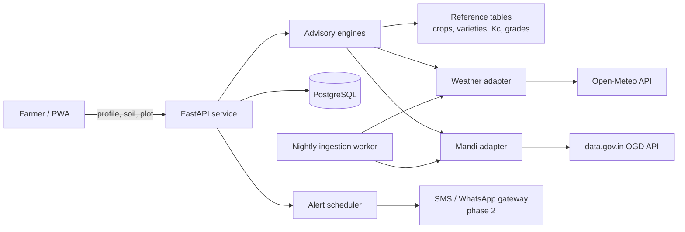
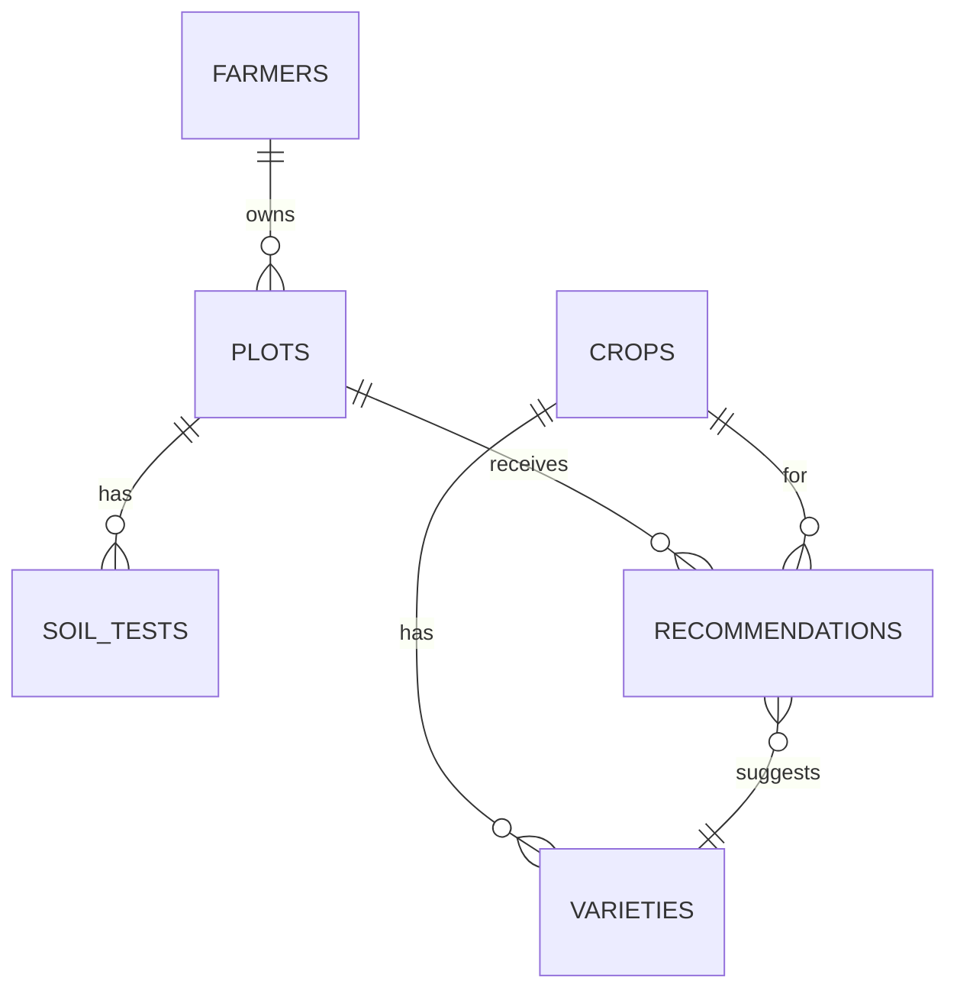

# KhetSathi 360 — Architecture Specification

Status: DRAFT for mentor review. This document describes the intended system;
no prototype code exists yet. Where a decision is provisional it says so.

---

## 1. Context

KhetSathi 360 is a decision-support service for smallholders in eastern Uttar
Pradesh. It consumes open agronomic and weather data, the farmer's own soil and
plot facts, and published package-of-practices tables, and returns an explained
advisory. It does not sell inputs, credit, or insurance.



## 2. Containers

| Container | Technology | Responsibility |
| --- | --- | --- |
| `web` | React + Vite, PWA (workbox) | Intake flow, advisory card, Hindi UI, offline cache |
| `api` | Python 3.12, FastAPI, Pydantic v2 | REST endpoints, auth, orchestration of engines |
| `worker` | Python, APScheduler or Celery | Nightly weather and mandi ingestion, alert dispatch |
| `db` | PostgreSQL 16 | All state; JSONB for payloads; PostGIS optional later |
| `proxy` | Caddy | TLS, compression, static hosting for the built PWA |
| `monitor` | Prometheus + Grafana (phase 2) | Latency, error rate, engine version distribution |

Deployment target for the internship: one 2 vCPU / 4 GB VM running Docker
Compose. Managed Postgres is an acceptable substitute. No Kubernetes.

## 3. Modules

| Module | Path (planned) | Purpose |
| --- | --- | --- |
| `farmers` | `src/api/routers/farmers.py` | Farmer and plot CRUD, OTP auth |
| `soil` | `src/api/routers/soil.py` | Soil test capture, quality flagging, SHC parsing |
| `advisory` | `src/api/routers/advisory.py` | Advisory generation and retrieval |
| `fertilizer` | `src/engine/fertilizer.py` | NPK dose, product split, arithmetic trail |
| `cropfit` | `src/engine/cropfit.py` | Crop and variety constraint filter and ranking |
| `irrigation` | `src/engine/irrigation.py` | Kc × ET0 water balance and schedule |
| `weather` | `src/adapters/weather.py` | Open-Meteo client, cache, fallback |
| `mandi` | `src/adapters/mandi.py` | OGD mandi price client |
| `schemes` | `src/engine/schemes.py` | Eligibility rules for PMFBY and state schemes |
| `alerts` | `src/worker/alerts.py` | Stage-boundary and weather-threshold dispatch |
| `reference` | `src/reference/` | Versioned tables loaded from `data/reference/` |

## 4. Data Model



| Table | Key columns |
| --- | --- |
| `farmers` | id, phone_hash, name, language, created_at, consent_at |
| `plots` | id, farmer_id, village, block, district, lat, lon, area_ha, irrigation_source |
| `soil_tests` | id, plot_id, sampled_on, source (`lab`, `shc`, `self_kit`, `block_baseline`), ph, ec, organic_carbon, n, p2o5, k2o, s, zn, b, fe, mn, cu |
| `crops` | id, name_en, name_hi, season, duration_days, zones[] |
| `varieties` | id, crop_id, name, notified_year, zone, sowing_window, seed_rate_kg_ha, traits[] |
| `reference_rules` | id, crop_id, rule_type, payload_json, source_citation, version |
| `recommendations` | id, plot_id, crop_id, variety_id, generated_at, engine_version, inputs_json, outputs_json, sources_json |
| `weather_cache` | grid_lat, grid_lon, forecast_date, payload_json, fetched_at |
| `mandi_prices` | commodity, market, price_date, min_price, max_price, modal_price, source |
| `schemes` | id, name, eligibility_json, documents[], window_note, link |
| `advisories` | id, farmer_id, kind, due_on, payload_json, channel, status |
| `audit_log` | id, actor, action, entity, entity_id, at |

Design rules: soil and advisory payloads are JSONB so engine versions can evolve
without migrations; every recommendation row is immutable; reference tables carry
a `version` and a `source_citation` so an advisory can be reproduced later.

## 5. Advisory Engines

### 5.1 Fertilizer

Primary path is a published soil-test-based recommendation. The general form of
a soil test crop response (STCR) target-yield equation is:

```
FN = a·T − b·SN − c·(ST − ST0)
```

where `T` is target yield, `SN` is soil available nitrogen, `ST` is the soil
test value, `ST0` is the control-plot value, and `a`, `b`, `c` are coefficients
fitted per crop and agro-climatic zone in AICRP-STCR trials. Coefficients are
zone-specific and must come from the published tables for the eastern plain
zone, not from another state.

MVP path (deterministic, explainable, honest about generality):

1. Read the state general recommendation for the crop and zone.
2. Adjust N by soil organic carbon and available N class; adjust P and K by soil
   test class relative to the critical value.
3. Convert elemental doses to product quantities: urea (46% N), DAP (18-46-0),
   MOP (0-0-60), SSP (0-16-0, with S and Ca credit).
4. Split by growth stage per the package of practices.
5. Emit the full arithmetic trail: every intermediate value with its rule id and
   source citation.

STCR equations replace steps 1–2 only when a zone-specific equation is
transcribed and reviewed. Until then the output is labelled "state
recommendation adjusted for your soil test", which is accurate.

### 5.2 Crop and variety

Constraint filter first, ranking second:

- Hard filters: season, zone, water availability class, soil pH and EC limits,
  duration against the next crop's sowing window.
- Ranking: published suitability, expected market signal if a price series
  exists, and distance from the plot's historical crop mix. The ranking must
  expose its factors.

Only notified varieties from the zone package are eligible. A variety without a
source citation cannot appear in an advisory.

### 5.3 Irrigation

FAO-56 simplification: `ETc = Kc × ET0`, with `Kc` from the
`data/reference/fao56-kc-values.md` table and `ET0` from Open-Meteo
(`et0_fao_evapotranspiration`). Effective rainfall is subtracted from forecast
`precipitation_sum` using a simple 80% effective-rainfall rule for the first
MVP, replaced later by a soil-water-balance model. Output is a schedule with
stage-critical windows flagged.

### 5.4 Weather alerts

Threshold rules on the daily forecast, aligned to IMD categories:

| Alert | Condition (daily) |
| --- | --- |
| Heavy rain | `precipitation_sum` ≥ 64.5 mm |
| Heat stress | `temperature_2m_max` ≥ 40 °C |
| Cold / frost risk | `temperature_2m_min` ≤ 4 °C |
| Spray window closed | `wind_speed_10m_max` > 20 km/h or rain probability high |
| Irrigation deferral | Forecast rain exceeds the plot's next irrigation need |

Alert text is Hindi and names the action, not just the hazard.

## 6. External Integrations

| Feed | Adapter behavior | Fallback |
| --- | --- | --- |
| Open-Meteo forecast | 16-day daily forecast and hourly soil moisture, cached per rounded grid cell for 6 hours | Serve stale cache with an age warning; NASA POWER for retrospective data |
| OGD mandi prices | Daily pull by commodity and district, stored as snapshots | Last snapshot with date shown; hide the price card if older than 7 days |
| OGD/IMD rainfall | Optional district series for context | Omit |
| Scheme metadata | Curated table, checked each season | Static table with a "verify on portal" note |

Verification status, licenses, and exact endpoints are in
`docs/API-CATALOG.md`. No adapter may call an external API in the request path
without a timeout and a cache.

## 7. API Surface (v1)

| Method | Path | Purpose |
| --- | --- | --- |
| POST | `/v1/auth/otp` | Request OTP for a phone number |
| POST | `/v1/auth/verify` | Exchange OTP for a JWT |
| GET/POST | `/v1/farmers/me` | Profile |
| GET/POST | `/v1/plots` | Plot list and create |
| POST | `/v1/plots/{id}/soil-tests` | Record a soil test |
| POST | `/v1/advisories` | Generate advisory for plot, season, crop |
| GET | `/v1/advisories/{id}` | Retrieve with sources and version |
| GET | `/v1/weather/{plot_id}` | Forecast and active alerts |
| GET | `/v1/mandi?commodity=&district=` | Price snapshot |
| GET | `/v1/schemes?crop=&season=` | Eligibility checklist |

Errors follow a single envelope: `{ok, data, error:{code, message_hi, message_en}}`.
Hindi messages are written for the farmer, English for the developer.

## 8. Non-Functional Requirements

| Concern | Requirement |
| --- | --- |
| Performance | Cached advisory p95 < 800 ms; first page payload < 300 KB |
| Connectivity | PWA shell and last advisory work offline; sync on reconnect |
| Devices | Android Chrome baseline; 360 px width minimum; large tap targets |
| Accessibility | WCAG 2.2 AA target; contrast and text scaling |
| Language | Hindi default, English toggle; glossary avoids Sanskritised jargon |
| Privacy | Phone number only, hashed for lookup; no Aadhaar; consent recorded; DPDP Act 2023 minimization |
| Security | JWT with short expiry, rate limiting on OTP, secrets in environment only, HTTPS everywhere |
| Auditability | Advisory reproducible from stored inputs, rule versions, and sources |
| Backups | Nightly `pg_dump` to off-box storage; restore tested once |

## 9. Testing Strategy

- Unit tests for engines with a 50-case golden set reviewed against published
  package-of-practices tables; agreement threshold 90%.
- Property tests for unit conversions (elemental to product, bags, splits).
- Adapter contract tests against recorded fixtures, not live APIs, in CI.
- Playwright happy-path E2E: village to advisory card.
- Field usability test per `docs/FIELD-RESEARCH-PROTOCOL.md` sampling.
- No advisory output ships without a `source_citation`; a test enforces it.

## 10. Open Architecture Questions

- [ ] Next.js instead of Vite if server-side rendering becomes necessary for
  first-load performance on 3G.
- [ ] Whether PostGIS is needed for village lookup or a static table suffices.
- [ ] Alert channel: SMS gateway cost versus WhatsApp Business API approval.
- [ ] Offline conflict handling when a farmer edits a plot while offline.

---

*Drafted from the 1M1B workbook and open-source data documentation verified in
this session. Status: DRAFT.*
